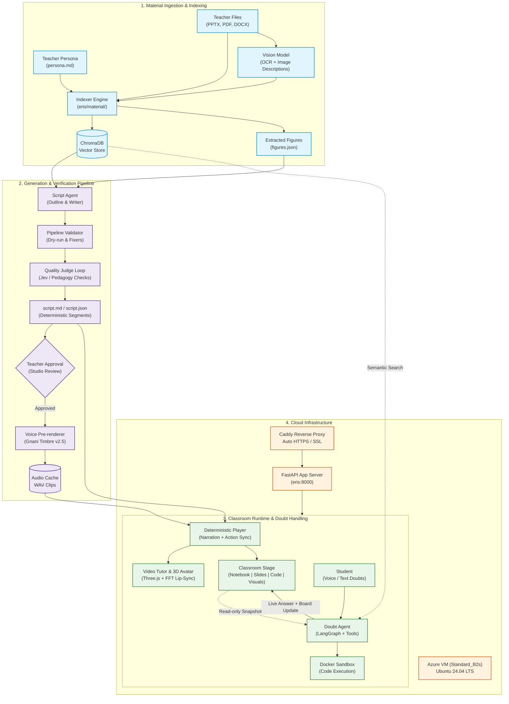

# 🎓 Eris — AI Substitute Teacher Platform

> **Autonomous, pedagogical AI teaching platform that transforms course materials into interactive, synchronized classroom lectures with video tutors, 3D avatars, dynamic stages, and live doubt resolution.**

[](https://eris.indiasouthcentral.cloudapp.azure.com/#/)
[](https://www.python.org/)
[](https://fastapi.tiangolo.com/)
[](https://threejs.org/)
[](https://www.docker.com/)

---

### 🌐 Live Deployment

Experience the live platform directly in your browser:  
👉 **[https://eris.indiasouthcentral.cloudapp.azure.com/#/](https://eris.indiasouthcentral.cloudapp.azure.com/#/)**

---

## 💡 Overview

When a teacher is away, Eris steps in. Teachers upload their slides or notes and define their teaching persona; Eris generates a verified lecture script in the teacher's voice, which the teacher reviews and approves. Students then join the course with a class code and take the lesson on their own devices: a voiced tutor teaches across presentation slides, a handwriting notebook, a code editor, and interactive graphs—answering student doubts live.

```
upload + persona ──► index ──► generate (draft) ──► checks (code + Jev) ──► approve ──► share ──► students learn
```

### Key Capabilities

- **Teacher-in-the-Loop Control**: The LLM drafts the lesson script; the teacher reviews, edits, and locks it before any student sees it.
- **Deterministic Player (No Speech Drift)**: In class, a plain-code player walks `script.json` sequentially. Narration and board actions are strictly synchronized: speech never outpaces writing or code execution.
- **4 Dynamic Classroom Environments**: Intelligently coordinates a ruled **Notebook**, presentation **Slides** (with pen highlights & circles), a live **Code Editor & Terminal**, and a **Visual Board** (step-by-step whiteboard flowcharts and interactive graphs with real-time sliders).
- **Video Tutor & 3D Avatar**: Displays a lifelike video tutor talking in sync with the audio, with a browser-based Three.js 3D avatar (Web Audio FFT viseme lip-sync) as a lightweight fallback.
- **10 Indian Languages**: Native voice and grammar support for English, Hindi, Tamil, Telugu, Kannada, Malayalam, Marathi, Bengali, Gujarati, and Punjabi.
- **Context-Aware Doubt Agent**: Students can ask doubts at any time by speaking or typing. A LangGraph agent reads the live board snapshot, searches course materials, and can write code or draw diagrams to answer without losing class progress.
- **Coursework & Attendance**: Organizes subjects into courses, chapters, topics, and prerequisite lessons. Tracks verified attendance based on segments students actively listen to.

```
┌────────────────────────┐      ┌─────────────────────────┐      ┌────────────────────────┐
│  Teacher Materials     │ ───► │  Script Generation &    │ ───► │  Interactive Class     │
│  • PPTX, PDF, DOCX     │      │  Quality Verification   │      │  • Video Tutor / Avatar│
│  • Teacher Persona     │      │  • Strict Parser        │      │  • Synchronized Stage  │
│  • Vision OCR & Schema │      │  • Code Dry-Runs        │      │  • Live Doubt Agent    │
│  • ChromaDB Index      │      │  • Teacher Approval     │      │  • Audio Pre-render    │
└────────────────────────┘      └─────────────────────────┘      └────────────────────────┘
```

---

## 🏛️ System Architecture

The end-to-end architecture from ingestion to classroom execution and deployment:



---

## 🖥️ The 4 Classroom Environments

The classroom stage dynamically adapts its workspace based on course materials:

| Environment | Purpose | When Used |
|---|---|---|
| **📝 Notebook** | Ruled blackboard with animated cursive handwriting, titles, and live text highlights. | Always active as the primary whiteboard. |
| **📑 Slides** | Slide viewer displaying presentations as images, highlighting specific lines, and circling figures. | Active when a PPTX deck or PDF slide deck is uploaded. |
| **💻 Code Editor** | Syntax-highlighted code editor with a sandboxed terminal for live code execution. | Active when lecture files contain programming code. |
| **📊 Visual Board** | Step-by-step whiteboard flowcharts and interactive graphs with real-time sliders. | Active when processes or mathematical charts are detected. |

---

## ⚡ Quick Start

### 1. Prerequisites
- **Python 3.12**
- **[uv](https://docs.astral.sh/uv/)** (recommended) or `pip`
- **[OpenRouter](https://openrouter.ai)** API key (with a tool-calling model like `openai/gpt-4o-mini` or `anthropic/claude-haiku-5.5`)

### 2. Installation

```bash
# Clone the repository
git clone https://github.com/Xtejasveer/Eris.git
cd Eris

# Create and activate virtual environment
uv venv --python 3.12
source .venv/bin/activate       # On Windows: .venv\Scripts\activate

# Install dependencies
uv pip install -r requirements.txt
uv pip install -r requirements-extras.txt  # Optional: photorealistic video avatar & faster-whisper

# Setup environment variables
cp .env.example .env
```

### 3. Configure Environment

Edit `.env` with your API keys:

```ini
OPENROUTER_API_KEY=your_openrouter_api_key
LLM_MODEL=openai/gpt-4o-mini
GNANI_API_KEY=your_gnani_api_key          # Optional: high-fidelity Indian English TTS/STT
```

> [!NOTE]
> If `GNANI_API_KEY` is omitted, Eris automatically falls back to the browser's native speech synthesis.

### 4. Run the Web Application

```bash
# (Optional) Seed demo accounts and courses for local testing:
python main.py seed

# Start the local server
python main.py serve
```

Open your browser at **[http://127.0.0.1:8000](http://127.0.0.1:8000)**:
- **Teacher View**: Manage courses, upload materials, generate scripts, review quality checks, and approve.
- **Student View**: Join with a course code, attend interactive lessons, and ask doubts in real time.

---

## 🐳 Docker Deployment

Run the complete production stack (Eris + Caddy with automatic SSL):

```bash
docker compose up -d --build
```

For full Azure VM setup and custom domain configuration, see [deploy/azure.md](file:///d:/Eris/deploy/azure.md).

---

## ⌨️ Command Line Interface

Eris can be completely controlled via the CLI:

| Command | Description |
|---|---|
| `python main.py serve` | Start the web application server (`http://127.0.0.1:8000`). |
| `python main.py seed` | Add demo accounts and courses built from lectures in `data/`. |
| `python main.py index --lecture <id>` | Build knowledge base and figures index from `data/<id>/`. |
| `python main.py generate --lecture <id>` | Write lesson outline and draft script (`status: draft`). |
| `python main.py approve --lecture <id>` | Validate script, dry-run code blocks, and approve (`status: approved`). |
| `python main.py render --lecture <id>` | Pre-render narration audio clips with Gnani TTS. |
| `python main.py session --lecture <id>` | Run the interactive terminal classroom session. |
| `python main.py stage --lecture <id>` | Re-stage saved `lesson.md` and report metrics. |
| `python main.py doubts --lecture <id>` | Test doubt agent checkpoints against full topic context. |
| `python main.py status --lecture <id>` | Display current manifest status and statistics. |
| `python main.py measure-voice` | Measure voice speed and persist `SPEAKING_WPM` in `.env`. |
| `python main.py tutor-video` | Generate classroom video tutor from idle and talking clips. |

---

## 🏷️ Script Markers Cheat Sheet

Scripts use clean inline markers parsed by `eris/generate/script_parser.py`:

| Marker | Description | Example |
|---|---|---|
| `[NOTE]` | Writes handwritten lines onto the notebook page. | `[NOTE]\nRepeats while condition is True\n[/NOTE]` |
| `[NOTE_TITLE]` | Underlined heading in the notebook. | `[NOTE_TITLE text="While Loops"]` |
| `[NOTE_HIGHLIGHT]` | Yellow highlighter over existing notebook text. | `[NOTE_HIGHLIGHT text="condition is True"]` |
| `[WRITE_CODE]` | Types code into the classroom code editor. | `[WRITE_CODE file="demo.py"]\nprint("Hello")\n[/WRITE_CODE]` |
| `[RUN]` | Executes a file in the code terminal. | `[RUN cmd="python demo.py"]` |
| `[READ_OUTPUT]` | Validates terminal output against expected result. | `[READ_OUTPUT]\nHello\n[/READ_OUTPUT]` |
| `[SLIDE]` | Displays a specific slide from the presentation deck. | `[SLIDE num=3]` |
| `[SLIDE_HIGHLIGHT]` | Highlights a specific line on the slide image. | `[SLIDE_HIGHLIGHT text="Key concept"]` |
| `[FLOW]` | Draws a block-by-block whiteboard flowchart. | `[FLOW id="loop" title="Loop Flow"]\nstep: Do work\n[/FLOW]` |
| `[VISUAL]` | Interactive graph with real-time sliders. | `[VISUAL id="chart" title="Distribution"]\ncontrols: mean (slider 0-10)\n[/VISUAL]` |
| `[DOUBT_CHECK]` | Pauses the lecture for student questions. | `[DOUBT_CHECK]` |
| `while_speaking=true` | Types code or notes *simultaneously* while speaking. | `[WRITE_CODE file="sum.py" while_speaking=true]` |

---

## 📁 Repository Structure

```
Eris/
├── main.py                     # CLI entry point (serve, index, generate, approve, render, session, seed)
├── eris/                       # Core Python package
│   ├── config.py               # Settings, environment paths, and lecture manifest
│   ├── persona.py              # Teacher persona parser
│   ├── prompts.py              # System prompts for researcher, writer, judge, and doubt agents
│   ├── material/               # Ingestion: PDF/PPTX/DOCX indexer, vision OCR, figure extractor, slides
│   ├── generate/               # Script pipeline: outline writer, parser, validator, and quality judge
│   ├── visuals/                # Visual board: flowchart renderer and interactive graph builders
│   ├── classroom/              # Class execution: doubt agent, session player, voice engine, actions
│   ├── platform/               # Multi-course database, attendance tracking, and demo seeders
│   └── api/                    # Web backend: FastAPI server, classroom endpoints, and job runners
├── web/                        # Frontend application (Vanilla HTML/CSS/JS, Three.js avatar)
│   ├── css/                    # Studio, classroom, platform, and landing styles
│   ├── js/                     # Client player, stage controllers, avatar engine, visual runtime
│   └── assets/                 # Video tutors, 3D avatar GLB models, and audio assets
├── deploy/                     # Production deployment: Caddy reverse proxy, Azure guide
├── templates/                  # Example persona templates (templates/persona.md)
└── docs/                       # Architectural design notes and implementation plans
```

---

## 🔧 Common Troubleshooting

<details>
<summary><b>Model does not call tools / returns tool error</b></summary>
Ensure <code>LLM_MODEL</code> supports tool-calling on OpenRouter (e.g., <code>openai/gpt-4o-mini</code> or <code>anthropic/claude-haiku-5.5</code>).
</details>

<details>
<summary><b>Script fails approval validation</b></summary>
Inspect <code>workspace/lectures/<id>/script_failed.md</code> for syntax issues or code mismatch errors. Edit <code>script.md</code> to fix the lines, then run <code>python main.py approve --lecture <id></code>.
</details>

<details>
<summary><b>Slides show as text, not pictures</b></summary>
PPTX decks require LibreOffice (<code>soffice</code>) installed to render slides as high-resolution images. PDF decks are rendered natively without LibreOffice.
</details>

<details>
<summary><b>Code lessons can't run programs</b></summary>
Start Docker (and pull <code>docker pull python:3.12-slim</code>) for containerized sandboxing, or set <code>ERIS_SANDBOX=os</code> in <code>.env</code> on macOS/Linux.
</details>

<details>
<summary><b>Sign-in refused with "This is a teacher account"</b></summary>
Select "I'm a teacher" or "I'm a student" on the landing page to match the created account role, then sign in.
</details>

<details>
<summary><b>Audio not playing / No Gnani API key</b></summary>
Gnani TTS is optional. Without <code>GNANI_API_KEY</code>, the web classroom automatically uses the browser's native Web Speech synthesis.
</details>

---

## 📄 License

This project is licensed under the MIT License.
